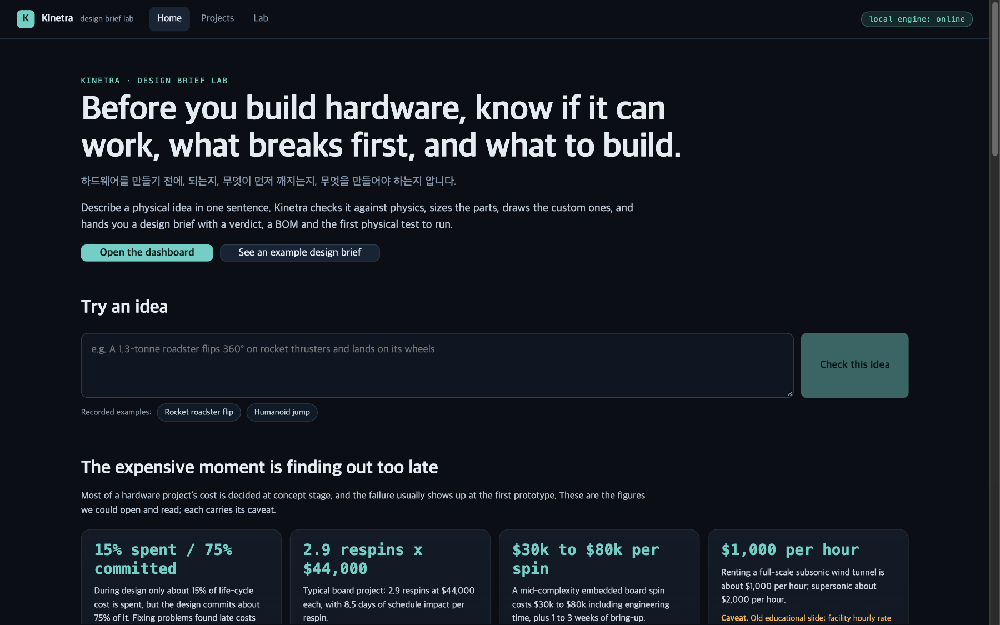
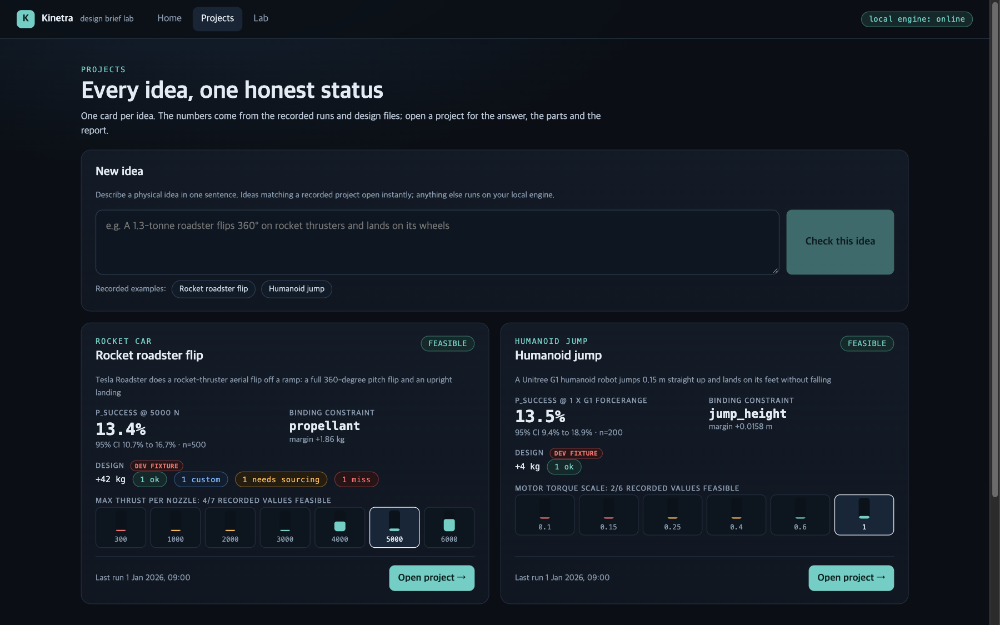
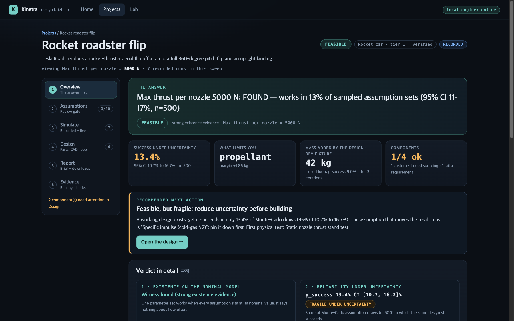
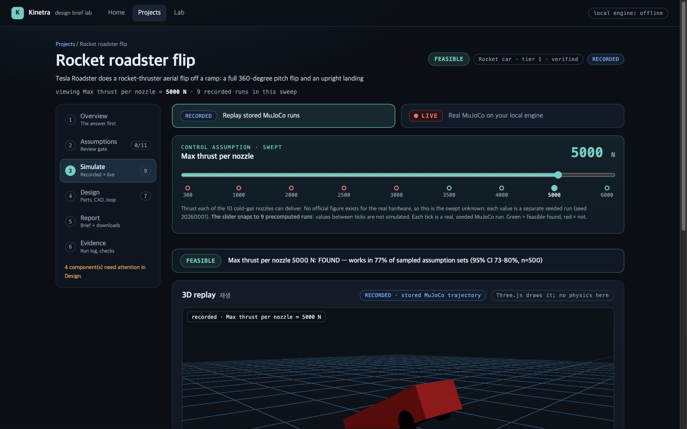
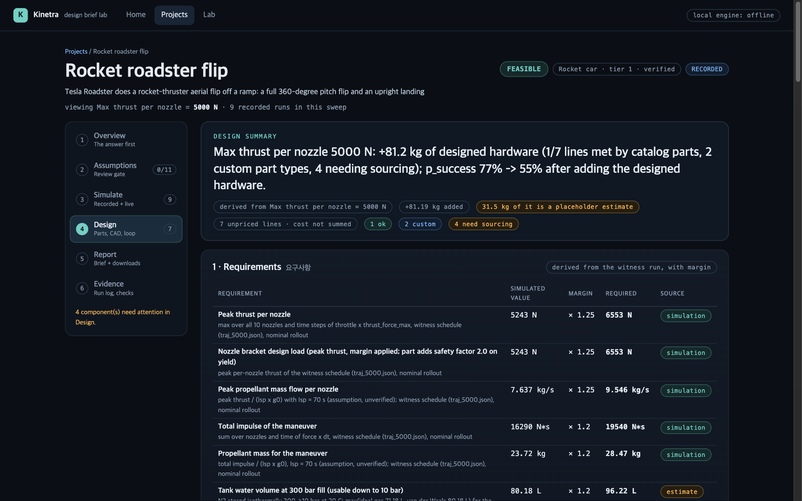
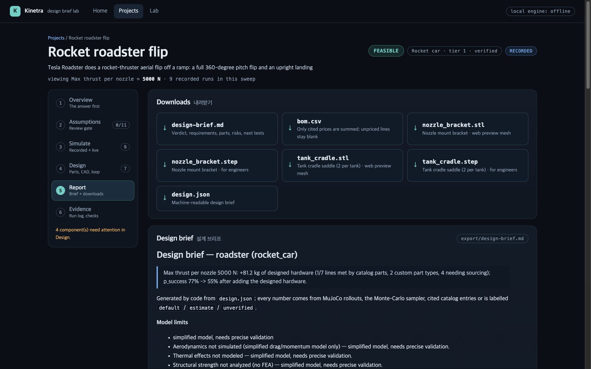
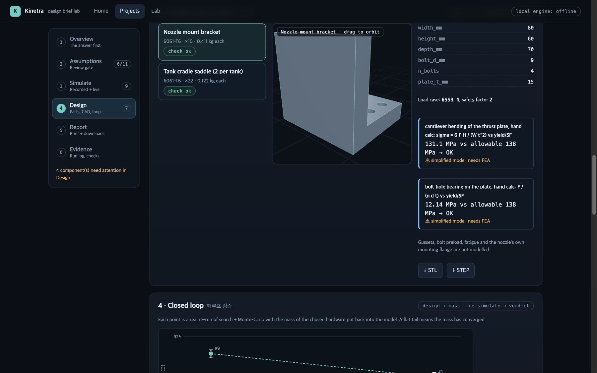
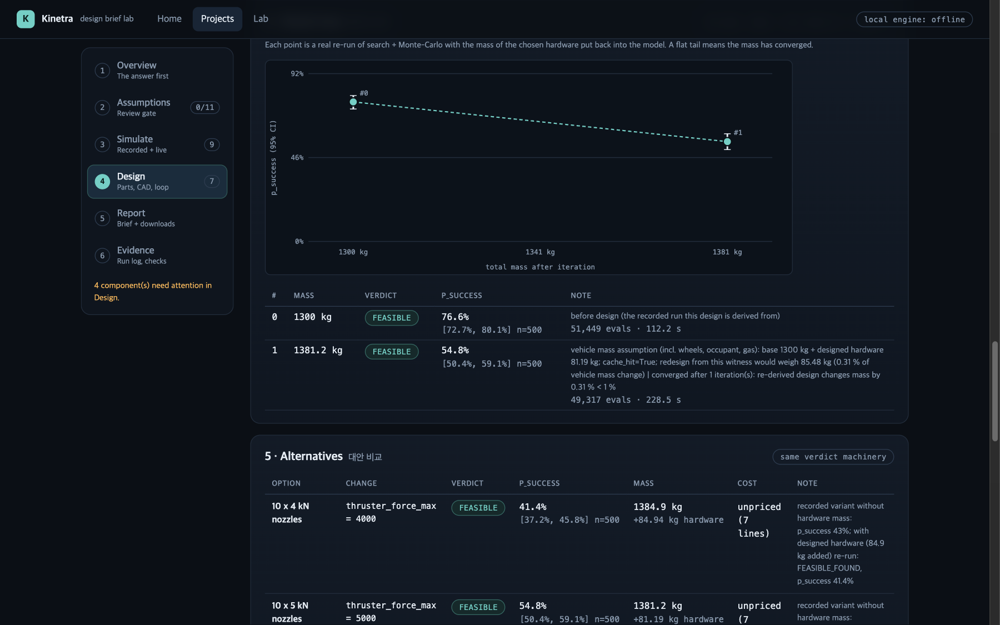
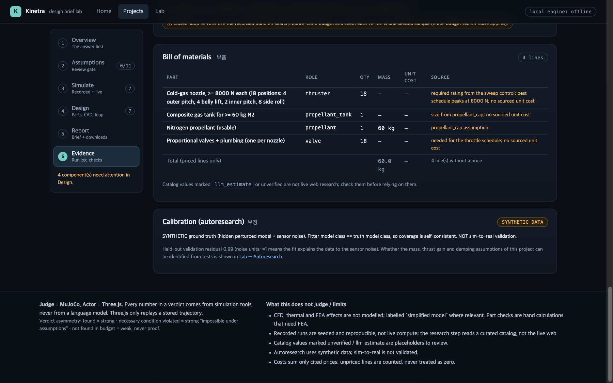
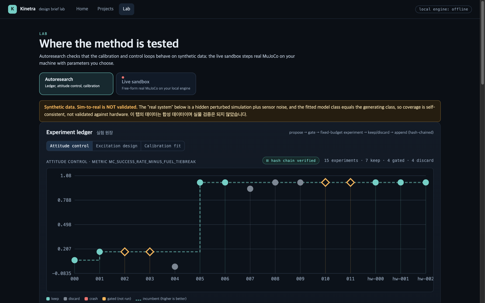

# Kinetra

> **Before you build hardware, know if it can work, what breaks first, and what to build.**
>
> 하드웨어를 만들기 전에, 되는지 · 무엇이 먼저 깨지는지 · 무엇을 만들어야 하는지 압니다.

Describe a physical idea in one sentence. Kinetra checks it against physics (MuJoCo), sizes the parts, draws the custom ones, and returns a **design brief**: a verdict with the strength of the evidence, the constraint that breaks first, sized components, custom parts with CAD, a BOM, risks and the first physical test to run.

**Every number comes from a simulation run or a cited catalog entry, never from an LLM.** Anything else is labelled `default`, `unverified` or `estimate`.

## Why this exists

Prototype respins and test campaigns are expensive, and most of a project's cost is locked in at concept stage. Kinetra is for the moment *before* you spend it: hardware founders deciding what the first prototype should be, robotics teams choosing an actuator or battery, makers without a test rig.

The full argument, with sourced figures (and their caveats), personas, what we do **not** claim, and how we would prove it: [`docs/why-kinetra.md`](docs/why-kinetra.md).

## Screenshots

Real captures (1440x900) of the production build on the committed bundles and design files (no fixtures).

| Home | Dashboard |
|---|---|
|  |  |

| Project overview (roadster, 5000 N) | Simulate: recorded replay (a LIVE mode switch sits beside it) |
|---|---|
|  |  |

| Design: requirements → parts → CAD → closed loop | Report: design brief + downloads |
|---|---|
|  |  |

| Design: custom parts with 3D CAD preview and hand-calc checks | Design: closed loop (mass fed back, verdict re-run) |
|---|---|
|  |  |

| Evidence | Lab |
|---|---|
|  |  |

## What you get: the design brief

| Section | What it contains |
|---|---|
| **Verdict** | `FEASIBLE_FOUND`, `INFEASIBLE_NECESSARY_CONDITION` or `NOT_FOUND_IN_BUDGET`, with `p_success` and a 95 % interval. |
| **What breaks first** | The binding constraint and its margin. |
| **Sized components** | Requirements derived from a real rollout of the witness design, times a margin, matched to cited catalog parts; unmatched lines become *custom* or *needs sourcing*. Never an invented vendor part. |
| **Custom parts + CAD** | Parametric geometry with a simple load check labelled "simplified model, needs FEA"; STL for preview, STEP for engineers. |
| **Closed loop** | The designed hardware's mass is put back into the model and the verdict re-run until it converges. |
| **BOM, risks, next test** | `bom.csv`; only cited prices are summed, unpriced lines are counted, never treated as zero. |

Contract between engine and web: [`docs/design-stage.md`](docs/design-stage.md).

### Verdict asymmetry (the core honesty rule)

| Outcome | Meaning | Strength |
|---|---|---|
| `FEASIBLE_FOUND` | a witness succeeds on the nominal model | strong *existence* evidence; reliability is the separate `p_success` ± CI |
| `INFEASIBLE_NECESSARY_CONDITION` | a necessary condition fails (energy, static torque, impulse) at the favorable end of the assumptions | strong "impossible under these assumptions" |
| `NOT_FOUND_IN_BUDGET` | search found nothing in N evaluations | **weak**, not a proof |

CFD, thermal and FEA are **not** judged; verdicts carry `simplified model, needs precise validation`. Details: [`docs/judgment-spec.md`](docs/judgment-spec.md).

## How it works

```
idea (one sentence)
  → assumptions   editable panel: value, distribution, source, confidence; low-confidence items need review
  → build model   verified template → MuJoCo MJCF
  → necessary-condition screen   cheap analytic/static checks that can PROVE "impossible"
  → search        CMA-ES over a 10–15 parameter control schedule, MuJoCo rollouts
  → Monte-Carlo   success probability + 95 % CI over the uncertain assumptions
  → fix search    the optimizer (not an LLM) sweeps one control to find the smallest verified fix
  → design        requirements → components → custom parts (CAD) → mass-feedback loop → alternatives
  → design brief  design-brief.md + bom.csv + CAD
```

**Judge = MuJoCo (physics), Actor = Three.js (replay).**

## The web app

Hash routes, no backend required (the demo replays committed, seeded bundles):

| Route | What it is |
|---|---|
| `#/` | **Home**: the problem, what you get, how it works, proof with real numbers from the bundles. |
| `#/projects` | **Dashboard**: one card per idea with status, `p_success` ± CI, binding constraint, design status. |
| `#/p/<id>/<tab>` | **Project workspace**: Overview · Assumptions · Simulate · Design · Report · Evidence. |
| `#/lab` | **Lab**: autoresearch (ledger, attitude control, calibration) and the free-form live sandbox. |

Two modes, labelled in the UI:
- **RECORDED** (default, no backend): replays committed, seeded runs ("recorded run, seeded & reproducible").
- **LIVE** (needs the local engine, `scripts/dev.sh`): a *real MuJoCo simulation on your machine* streamed to the 3D view over a WebSocket. If the engine is not reachable the LIVE panel is disabled and shows the start command. Protocol: [`docs/live-mode.md`](docs/live-mode.md).

A narrated presentation build (`present.html`) is documented in [`docs/pitch/README.md`](docs/pitch/README.md).

## Measured results (and their limits)

All numbers were produced by the code in this repo. Spikes are in [`spikes/`](spikes/); production-path numbers are in the committed bundles under `apps/web/public/demo/`.

Verified in this repo: `POST /simulate` on the roadster at 5 kN is deterministic (identical trajectory hash on repeat) and runs ~29,000 steps/s (4.5 s of sim in ~39 ms); at 1 kN the same endpoint reports the failed checks (`flip_final`, `flip_td`, `impact_vz`, …). Humanoid live mode is a batch rollout that is then paced (not incremental stepping), and live search is roadster-only.

**Roadster (1,300 kg, 10 cold-gas nozzles, ramp launch, 360° flip + upright landing)**

| Source | Result |
|---|---|
| Spike (`spikes/roadster/REPORT.md`) | 5 kN: flip found in 3.4 s / 3,072 rollouts; 16 extra seeds all succeeded. 300 N proven infeasible (needs 3.34 s to rotate, ≤ 2.43 s flight). 2–3 kN: `NOT_FOUND` (weak). |
| Engine bundle (current) | 300 N `INFEASIBLE`; 1–3 kN `NOT_FOUND` (weak); 3.5 / 4 / 5 / 6 kN `FEASIBLE_FOUND` with `p_success` 21.2 / 43.0 / 76.6 / 83.4 % (n = 500). Optimizer fix for failing variants: 5 kN (smallest tested value with verified `p_success` ≥ 50 %). |
| Design stage (5 kN base) | +81.2 kg of designed hardware (31.5 kg of it placeholder estimates); closed loop re-run: `p_success` 76.6 % → **54.8 %** [50.4, 59.1] after adding it. Alternatives: 10 × 6 kN recommended (61.6 %). |

Limits we know about:
- **The current bundle does not sample per-nozzle thrust error** (`thrust_spread` = 0, `thrust_error` = 0; the spike's effective disturbance set: mass ±5 %, COM offset). With ±10 % per-nozzle thrust noise the engine measured ~13 % at 5 kN instead of ~77 %. The spike's original 83–85 % figure had that noise silently not applied (it wrote to `actuator_gear[:,0]`, which is 0 for these motors).
- The hackathon-era bundle (thrust noise on) showed `p_success` 3.6 / 46.6 / 13.4 / 58.4 % at 3 / 4 / 5 / 6 kN; it cannot be reproduced under current code, and its recorded witnesses no longer pass.
- Per-nozzle thrust of the real hardware is unknown; no catalogued cold-gas thruster comes close (largest read: 8.9 N vs 6,553 N required), so nozzles, valves and regulator are *needs sourcing*.
- Standing-start jump: not found (weak evidence only). Cold-gas Isp (70 s), tank and structure limits are unverified defaults.

**Unitree G1 humanoid jump (Menagerie model, 10 parameters, no RL)**

| Torque scale | Verdict | p_success |
|---|---|---|
| 0.10× / 0.15× | `INFEASIBLE_NECESSARY_CONDITION` (static hold needs 15.7 N·m vs 13 available; takeoff energy 48.3 J vs 27.0 J) | – |
| 0.25× / 0.40× | `NOT_FOUND_IN_BUDGET` (weak) | – |
| 0.60× / 1.00× | `FEASIBLE_FOUND` | 5.0 % / 13.5 % (n = 200) |

Limits: the hero target is **0.15 m**, not 0.3 m (at 0.3 m the controller reached 0–3 % on all 3 probe seeds). Success is low under the sampled mass/friction/torque/COM/landing-force uncertainty; we did not shrink the disturbances. The 9× body-weight landing-force limit is an unverified default. Contact is MuJoCo's default soft contact, uncalibrated; only the sagittal plane was exercised.

Design stage (1.0× base): knee needs 180.7 N·m with margin; the strongest catalogued actuator (CubeMars AKE90-8) peaks at 170 N·m, so the knee is *needs sourcing*; hip and ankle lines are met by verified CubeMars parts. Adding the designed hardware (+12 kg, on top of G1 link masses that already include motors, so this overstates the effect) gives `NOT_FOUND_IN_BUDGET` (weak), and the loop stops there.

**Autoresearch** ([`docs/autoresearch.md`](docs/autoresearch.md)): propose → fixed-budget experiment → one metric → keep/discard → append-only hash-chained ledger; physical-assumption changes are gated behind human approval.
- Attitude control (toy 10 kg single-axis article): open-loop schedule 5.5 % [3.1, 9.6] vs PD/hybrid feedback 100 % [98.1, 100] on 200 held-out samples. PD and hybrid are indistinguishable on this metric.
- Calibration on **synthetic** data: recovers 9/9 hidden parameters on the recommended campaign; a couple-only campaign correctly reports contact parameters as *not identified*.

## What is *not* proven

- **Sim-to-real is not validated.** No real hardware data was used.
- **Willingness to pay is unvalidated.** No customers, revenue or traction. The planned 3-way comparison (by hand / general coding agent / Kinetra) and 5 design-partner interviews are specified in [`docs/why-kinetra.md`](docs/why-kinetra.md) §7 and have **not** been run.
- Rocket and humanoid physics are rigid-body models with default, partly unverified parameters. Real-world cost references ([`docs/judgment-spec.md`](docs/judgment-spec.md) §D, [`docs/why-kinetra.md`](docs/why-kinetra.md) §1) are cited where sourced and marked otherwise; vendor blogs are flagged as such.
- Part checks in the design stage are hand calculations ("simplified model, needs FEA"), not finite-element analysis.

## Run it

Requirements: Python ≥ 3.10 with [`uv`](https://docs.astral.sh/uv/), Node ≥ 20 with `pnpm`.

```bash
# Web demo (uses the committed recorded bundles)
cd apps/web && pnpm install && pnpm dev          # http://localhost:5173
pnpm build                                        # strict TS + production build

# Engine (rebuild bundles / live API)
uv venv packages/engine/.venv && uv pip install --python packages/engine/.venv/bin/python -e . -e packages/engine
packages/engine/.venv/bin/python packages/engine/scripts/build_rocket_bundle.py     # ~10–25 min cold, seconds cached
packages/engine/.venv/bin/python packages/engine/scripts/build_humanoid_bundle.py   # needs MuJoCo Menagerie, see below
packages/engine/.venv/bin/python packages/engine/scripts/build_autoresearch_bundle.py   # ~3 min
packages/engine/.venv/bin/python packages/engine/scripts/build_design_bundle.py         # design.json + cad/*.stl|step + export/{design-brief.md,bom.csv} per scenario
cd packages/engine && .venv/bin/uvicorn kinetra_engine.api:app --port 8000          # live engine API (or: scripts/dev.sh = engine + web together)

# Tests
packages/engine/.venv/bin/python -m pytest packages/engine/tests -q
```

The humanoid build needs the G1 model: `git clone --depth 1 https://github.com/google-deepmind/mujoco_menagerie spikes/humanoid_jump/vendor/mujoco_menagerie` (BSD-3-Clause; or set `KINETRA_MENAGERIE`). Recorded bundles and converted GLB meshes are already committed, so the demo does not need it.

## Repository layout

| Path | Contents |
|---|---|
| `apps/web/` | Vite + React + R3F app (Home, Dashboard, Project workspace, Lab), presentation mode (`present.html`); typed Home copy in `src/content/` |
| `packages/core/` | `physlab_core`: Pydantic contracts (`SpecSheet`, `Trajectory`, `Verdict`, `DesignBrief`) |
| `packages/engine/` | `kinetra_engine`: pipeline, templates (`rocket_car`, `humanoid_jump`), catalog, Monte-Carlo, autoresearch, FastAPI |
| `schemas/` | generated JSON Schemas + `types.ts` (`uv run python packages/core/scripts/export_schemas.py`) |
| `spikes/` | Go/No-Go spikes with `REPORT.md`s: `roadster/`, `humanoid_jump/`, `autoresearch/` |
| `docs/` | `why-kinetra.md` (reason to exist), `design-stage.md`, `judgment-spec.md`, `autoresearch.md`, `live-mode.md`, `demo-bundle.md`, `schemas.md`, `pitch/` |
| `tools/film/` | scripted, TTS-narrated demo film pipeline |

## Roadmap

1. **Validate the reason to exist** before building more: 5 design-partner interviews and the 3-way benchmark ([`docs/why-kinetra.md`](docs/why-kinetra.md) §7).
2. More verified templates (drone, vehicle, robot arm); the template contract is `packages/engine/src/kinetra_engine/base.py`.
3. User-supplied URDF/CAD upload.
4. Calibration on real traces; measure the sim-to-real gap (e.g. a physical SO-101), the long-term moat.
5. Surrogate models trained on accumulated verdicts to speed up sweeps.

Open-source building blocks: [MuJoCo](https://github.com/google-deepmind/mujoco), [MuJoCo Menagerie](https://github.com/google-deepmind/mujoco_menagerie) (Unitree G1), [pycma](https://github.com/CMA-ES/pycma), Three.js / React Three Fiber, Pydantic, FastAPI.
