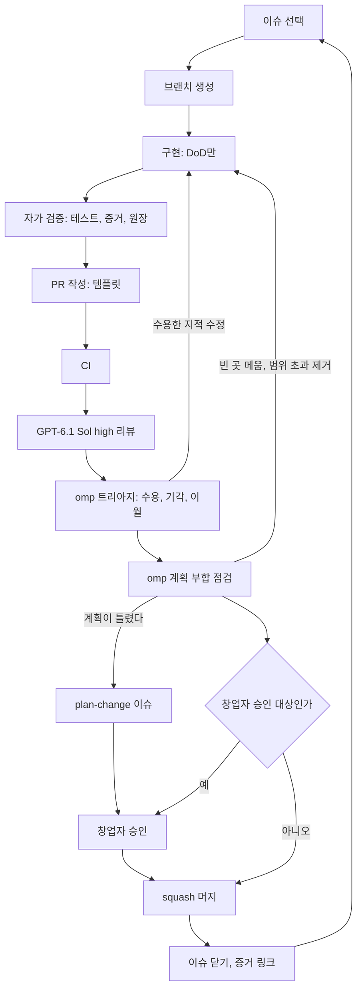

# Kinetra 실행 계획 — 비전 보강, 에셋 정책, 이슈 체계, 개발 루프

> 기준 문서는 `final-plan.md`(승인된 12주 계획)다. 이 문서는 그 위에 창업자의 새 요구 5가지를 얹는다. 표기는 같다: **[추정]**, **[확인 필요]**, **[제안]**. 표기 없는 사실은 오늘 저장소(`NomaDamas/Kinetra`, main `6065cca`)와 OpenRouter 모델 목록에서 확인했다.

## A. 보강된 비전

**북극성:** 누구든 떠올린 상상을 실제 물리로 판정받고, 된 것은 영상·미션·실물로 이어 간다. 경로는 **생각 → 상상 → 실제 물리 세계**다.

**핵심 가치** (모든 이슈·PR 머리에 원문 그대로 인용한다. 단일 원본은 `docs/plan/values.md`)

- **V1 정직한 판정** — 판정은 시뮬과 몬테카를로만 한다. 확률, 가정, 한계를 숨기지 않는다.
- **V2 상상에서 현실까지** — 모든 기능은 생각 → 상상 → 실제 물리 세계의 거리를 줄여야 한다.
- **V3 한 번에 100%** — 작은 단위를 증거와 함께 완전히 끝낸다. 부분 완성은 미완성이다.
- **V4 보여줄 수 있는 결과** — 결과는 시뮬 리플레이 그대로 영상과 플레이 링크가 된다. 물리와 다른 장면은 만들지 않는다.
- **V5 깨끗한 출처** — 수치, 부품, 에셋은 출처와 라이선스가 기록된 것만 쓴다.

**우리 길이 다른 점(정직하게).** 세부 기능 비교는 [확인 필요].

| 비교 대상 | 그쪽이 이기는 것 | 우리가 다른 것 |
|---|---|---|
| KSP, Juno | 궤도역학, 로켓 콘텐츠 | 지상 행성 미션, 성공 확률과 가정 공개 |
| Space Engineers | 건설 규모, 생존, 멀티 | 실제 재료·부품 사양에서 부품표가 나온다 |
| Besiege | 조립의 손맛, 퍼즐 수 | 조립 결과가 실물 검증과 키트로 이어진다 |
| GTA | 저작된 도시, 서사, 연출 | 탈것을 직접 만들고 스턴트마다 판정이 붙는다 |

기능은 해자가 아니라는 final-plan 10절의 결론은 그대로다. 다른 점은 "판정 → 영상 → 실물"이 한 줄로 이어진다는 것뿐이고, 아직 가설이다.

**단계.** Go 게이트는 final-plan 12절의 12주 판정이다.

| 단계 | 게이트 | 정직한 최소판 | 하지 않는 것 |
|---|---|---|---|
| S1 MVP(달 로버) | 12주, Go 이전 | final-plan 12절 그대로 | 궤도, 화성, 기지, 실시간 멀티 |
| S2 지구 검증 | 1건은 12주 차. 확장은 Go와 무관하게 계속(No-Go면 주력) | 키트 차량 등판 한계 예측 대 실측 | 합성 데이터 보정을 검증이라 부르기 |
| S3 Halo Studio | v0는 9주 차 산출물 그대로, v1은 Go 뒤 [제안] | 검증된 리플레이 → 카메라 프리셋 → 판정 자막 → 영상 + 엔드카드 | 물리와 다른 연출, AI 영상으로 물리 장면 만들기 |
| S4 오픈월드/미션 | Go 뒤 | 수 km 맵 1~2개, 자유 주행, 미션 표지 3~5개, 파단으로 생기는 소동 | 도시, NPC, 교통, 서사 |
| S5 만화 사고실험 | Go 뒤 | 장면을 질량·속도·높이·시간으로 옮겨 필요조건·에너지 예산 판정 카드를 낸다. 강체로 되는 것(도약, 투척, 차량, 충돌)만 시뮬한다 | 에너지 빔, 기, 변신, 마법의 시뮬. 원작 캐릭터 외형과 화면 |
| S6 멀티/PvP | Go 뒤 | 고스트 레이싱 → 학교 대회 → 협동 → PvP | 지연 보상 없는 실시간 PvP |
| S7 하드웨어 키트 | Go 뒤, 지구 검증 오차 15% 이하 | 시뮬 제어값을 키트 차량에 이식해 비교 | 실물 검증 전 로봇 학습 약속 |

**비판적 메모.**

1. **GTA는 콘텐츠 싸움이다.** 도시와 NPC는 소수 인원이 못 만든다. 가져올 것은 구조(열린 맵, 탈것, 미션 표지, 사고의 재미)뿐이다. 웹 + MuJoCo는 다수 물체에 약하므로 S4는 Godot 스파이크 결과에 묶인다.
2. **만화 물리의 대부분은 시뮬 대상이 아니다.** 판정은 셋으로 나눈다: 강체로 시뮬 가능 / 필요조건으로 불가능 증명("이 도약에 필요한 출력은 사람 근육의 몇 배") / 모델 밖(판정 불가). 기존 판정 비대칭을 그대로 쓴다.
3. **Halo는 final-plan과 부딪힌다.** 2절은 "단발 히어로 데모"를 버렸고 7절은 미디어가 유료 깔때기가 아니라고 했다. 이 문서는 단발 데모는 계속 버리고 **반복 생산 경로**만 받아들인다. v0는 9주 차 산출물과 같은 것이라 범위가 늘지 않는다. 지표는 여전히 엔드카드 전환 5%다.
4. **로드스터 Halo의 현재 근거는 약하다.** 저장소 번들 기준 노즐당 8 kN에서 p_success 15.2% [12.3, 18.6], 노즐별 추력 잡음 ±10%에서 0.8%이고, 카탈로그 최대 추력은 8.9 N이다. 영상에는 이 수치가 그대로 들어가야 한다. 상표와 차체 디자인은 [확인 필요]이므로 자체 제작 차체와 이름 언급만 쓴다.
5. S4와 S5는 final-plan의 Go 이후 목록에 없던 단계다. 계획 변경으로 `docs/decisions/`에 기록하고 창업자가 승인한다.

## B. 에셋 정책

원칙은 final-plan 6절 그대로다. 시각 메시와 물리 모델을 분리하고, 물리 부품의 형상은 파라메트릭 정의에서만 나온다. 인터넷 에셋은 시각 전용이다.

| 출처 | 허용 조건 | 주의 |
|---|---|---|
| Poly Haven | CC0 텍스처·HDRI·모델 | 원장 기입만 |
| ambientCG | CC0 재질 | 원장 기입만 |
| NASA 3D Resources | NASA 미디어 사용 지침을 따른다 | 기장·로고·승인 암시 금지, 제3자 저작물이 섞인 모델 [확인 필요] |
| Sketchfab | CC0, CC-BY만. 저작자 표기 필수 | NC·ND·SA·스토어 라이선스 제외. 올린 사람이 원작자인지 확인한다(게임 추출물이 CC-BY로 올라온다) |
| Smithsonian 3D | 오픈 액세스 CC0 표시 항목만 | 항목별 표시 [확인 필요] |
| 공개 DEM | 달 고도 자료 | 인용 조건 [확인 필요] |
| MuJoCo Menagerie | BSD-3(G1 GLB 36개가 이미 커밋돼 있다) | 원장에 소급 기입 |
| AI 생성 메시 | 장식·스킨만 | 모델 라이선스 [확인 필요] |

**금지:** 게임에서 추출한 에셋, 만화·애니 캐릭터와 로고, 실제 브랜드 상표·차체 복제, 상업 이용 불가(NC) 라이선스, 출처를 모르는 파일. 만화·애니는 오리지널 캐릭터와 이름 언급 해설만 허용한다(법률 검토 [확인 필요]).

**출처 원장:** `assets/LEDGER.csv`. 열은 에셋 ID, 경로, 원본 URL, 저작자, 라이선스(SPDX), 받은 날짜, 원본 해시, 변경 내역, 용도(시각/HDRI/소리), 표기 문구, 확인자다. `CREDITS.md`와 앱 안 크레딧 화면은 원장에서 생성한다.

**Blender 파이프라인** (blender-mcp는 제작 보조. 확정된 절차는 `tools/assets/`의 헤드리스 스크립트로 남겨 재현한다)

1. 가져오기: 단위(미터)와 축 정리, 로고·기장 제거
2. 리토폴로지 또는 감량: 삼각형 상한 [제안: 소품 5만]
3. UV, PBR 베이크(색, 노멀, ORM, 2K)
4. glb 내보내기, 파일당 용량 상한 [제안: 5 MB]
5. 물리 프록시는 따로: 기본형·볼록체를 수작업 또는 파라메트릭 정의에서 만든다
6. 원장 행 추가, 전후 스크린샷

**라이선스 게이트:** 에셋 경로를 건드린 PR은 원장 차이가 없으면 CI가 실패한다(`scripts/check_assets.py`). 리뷰 루브릭 5번이 라이선스와 표기를 다시 본다. CC0가 아닌 에셋의 머지는 창업자 승인이다.

## C. 이슈 체계

**계층:** 에픽 → 이슈 → 하위 이슈(GitHub 하위 이슈 기능). PR 하나는 잎 이슈 하나만 닫는다. 쪼개는 목적은 한 번에 100% 끝내는 것이다. 하루를 넘는 단위는 쪼갠다.

**라벨**

| 축 | 값 |
|---|---|
| `type:` | epic, feature, task, bug, research, asset, docs, infra, plan-change |
| `area:` | engine, parts, world, judge, web, ai, edu, media, assets, server, process, biz |
| `stage:` | S0-process, S1-mvp, S2-earth, S3-halo, S4-openworld, S5-manga, S6-multi, S7-kit |
| `prio:` | P0(이번 주 경로), P1, P2 |
| `size:` | XS(2시간 이하), S(반나절), M(하루). L은 등록 금지, 쪼갠다 |
| 상태 | `needs-founder`, `blocked`, `license-check` |

크기 **F**는 창업자가 직접 하는 일(인터뷰, 파일럿, 실측)이다. 달력 시간이 걸리고 WIP에 넣지 않는다.

**마일스톤:** `S0 Process`, `MVP-W01` … `MVP-W12`(주마다 하나, 마감은 그 주 금요일), `S2 Earth`, `S3 Halo`, `S4 Openworld`, `S5 Manga`, `S6 Multi`, `S7 Kit`.

**이슈 템플릿**

```markdown
## 대목표
<에픽 대목표 한 줄> (#에픽, docs/plan/… 절)
## 핵심 가치
> <values.md 원문 1~2개>
이 이슈가 그 가치를 지키는 방식: <한 줄>
## 문제
지금 무엇이 안 되는가. 이 이슈가 없으면 대목표의 무엇이 막히는가.
## 완료 정의 (DoD)
- [ ] <관찰 가능한 결과>
- [ ] 테스트: <무엇을 단언하는가>
- [ ] 증거: <스크린샷·영상·수치(명령, 시드)>
- [ ] 문서·원장 갱신
## 범위 밖
## 검증 방법
<명령어와 기대 결과>
## 의존성
선행 #… / 후속 #…
```

**PR 템플릿**

```markdown
## 대목표
## 핵심 가치
> <원문 인용> — 이 PR이 없으면 대목표의 무엇이 안 되는가: <한 줄>
## 문제
Closes #<잎 이슈 하나>
## 완료 정의 대조
- [ ] <이슈 DoD 항목> → <증거 링크>
## 범위 밖
하지 않은 것과 새로 등록한 이슈 #…
## 검증 방법
실행한 명령과 실제 출력
## 의존성
## 정직성·라이선스
새 수치의 출처 또는 default/unverified/estimate 표기, 원장 행, 새 의존성 라이선스
```

**"100% 완료"의 정의** (하나라도 빠지면 머지하지 않는다)

1. 이슈 DoD 체크박스가 모두 증거와 함께 닫혔다.
2. 테스트가 있고 CI(`pytest packages/engine/tests`, `pnpm lint && pnpm build`)가 초록이다. 단언을 약하게 고치지 않았다.
3. 화면·시각 변경은 스크린샷이나 영상, 엔진 변경은 재현 명령과 시드가 붙었다.
4. 문서(README, `docs/`, 스키마)가 코드와 맞는다.
5. 에셋·의존성은 원장과 라이선스 기록이 있다.
6. TODO, 스텁, 목, 가짜 대체 경로가 없다.
7. 새 수치에는 출처나 정직성 라벨이 있다.
8. DoD 밖에서 발견한 일은 고치지 않고 새 이슈로 남겼다.

## D. 이슈 트리

**대목표 코드** (각 에픽 머리줄에 적고, 그 아래 이슈는 모두 상속한다)

- **G0** 모든 작업이 대목표·핵심 가치·계획에 묶여 한 번에 100% 끝나는 루프를 만든다.
- **G1** 12주 안에 달 로버 미션 하나로 Go/No-Go 지표 8개를 측정한다(final-plan 12절).
- **G2** 예측과 실측을 대조해 판정의 신뢰를 만든다. **G3** 창업자가 상상 하나를 검증된 공유 영상으로 반복 생산한다. **G4** 직접 만든 탈것으로 열린 세계를 돌아다니며 미션을 깬다. **G5** 만화 장면이 실제로 되는지 필요조건과 에너지로 답한다. **G6** 설계로 겨루고 함께 짓고 부순다. **G7** 시뮬에서 된 설계가 실물 키트로 이어진다.

표 읽는 법: 굵은 행은 부모 이슈(DoD = 하위 이슈 전부 닫힘 + 통합 시연 증거), 글자가 붙은 행은 하위 이슈다. 의존 칸에서 에픽 접두가 없으면 같은 에픽 안이다. 모든 잎의 DoD에는 C절의 8개 항목이 기본으로 붙고, 표에는 그 이슈만의 조건을 적었다.

**착수 순서(첫 10개):** P0-01 → M1-01a → M1-01b → P0-02 → P0-03 → P0-04 → P0-09 → P0-05a → P0-05b → P0-07a. 1주 차에는 창업자가 인터뷰를 하고 에이전트가 P0와 스키마를 만든다. P0-07이 끝나기 전의 PR은 같은 루브릭을 수동 호출로 적용한다.

### EPIC P0 — 개발 루프 인프라 · G0 · `S0 Process`

| ID | 제목 | 크기 | 의존 | DoD |
|---|---|---|---|---|
| P0-01 | 계획·가치 문서 반입 `docs/plan/{final-plan,execution-plan,values}.md` | XS | — | values.md가 단일 원본, README 로드맵이 계획을 가리킨다 |
| P0-02 | 라벨·마일스톤 부트스트랩 `scripts/gh/bootstrap.sh` | S | — | C절 전부 생성, 재실행해도 중복 없음 |
| P0-03 | 이슈 템플릿 `.github/ISSUE_TEMPLATE/{epic,work,asset,research}.yml` | S | 01 | 빈 이슈 비활성, 대목표·핵심 가치 필수 |
| P0-04 | PR 템플릿 `.github/pull_request_template.md` | XS | 01 | C절 문안과 일치 |
| **P0-05** | **CI** | | | |
| P0-05a | 엔진: uv + `pytest packages/engine/tests -q` | S | — | main 초록, 건너뛴 테스트가 로그에 보인다 |
| P0-05b | 웹: `pnpm install --frozen-lockfile && pnpm lint && pnpm build` | XS | — | main 초록 |
| P0-05c | 본문 검사: 대목표, 핵심 가치, `Closes #` | S | 03, 04 | 위반 PR 예시가 실패한다 |
| **P0-06** | **에셋 원장** | | | |
| P0-06a | `assets/LEDGER.csv` + `CREDITS.md` 생성기 | S | — | G1 GLB 36개 소급 기입 |
| P0-06b | `scripts/check_assets.py` + CI | S | 06a | 원장에 없는 에셋이 있으면 실패 |
| **P0-07** | **리뷰 봇 `tools/review/`** | | | |
| P0-07a | 수집: PR diff, 연결 이슈 본문, 계획 발췌(stage·area 라벨 → 절) | M | 01 | 생성물·lock·번들 제외, 상한을 넘으면 파일 단위로 나눈다 |
| P0-07b | OpenRouter 호출: `openai/gpt-6.1-sol`, reasoning high, 루브릭 JSON | S | 07a | 스키마 검증, 실패 시 1회 재시도, 비용 기록 |
| P0-07c | 게시: `gh pr comment`, 마커로 코멘트 하나만 갱신 | S | 07b | 재실행해도 코멘트 1개 |
| P0-07d | 실행기 `scripts/review_pr.sh <PR>`, Actions 수동 실행(선택) | S | 07c | 키는 환경변수·시크릿만, 로그에 없음 |
| P0-07e | 봇 검증: 결함을 심은 PR 3건(범위 초과, 출처 없는 수치, 원장 누락) | S | 07d | 3건 모두 지적, 오탐 기록 |
| P0-08 | 머지 체크리스트·브랜치 보호 `docs/process/merge-checklist.md` | XS | 05 | main 직접 푸시 금지, CI 필수, squash |
| P0-09 | 이슈 일괄 등록 `scripts/gh/seed_issues.py` ← `docs/plan/issues.yaml` | M | 02, 03 | dry-run, 하위 이슈 연결, ID 기준 재실행 안전 |
| P0-10 | 트리아지 기록 양식 `docs/process/triage.md` | XS | 04 | 수용/기각/이월 표 |

### EPIC M1 — 1주: 인터뷰, 미션 명세, 스키마 · G1 · `MVP-W01`

| ID | 제목 | 크기 | 의존 | DoD |
|---|---|---|---|---|
| **M1-01** | **교사·학생 인터뷰 10건** | | | |
| M1-01a | 인터뷰 가이드(교사용·학생용: 지불, 수업 시간, 기기 환경) | S | — | 유도 질문 검토 기록 |
| M1-01b | 모집: 후보 15명, 일정 10건 확정 | F | 01a | 교사 6명 이상 [제안] |
| M1-01c | 인터뷰 1~5 | F | 01b | 동의, 익명 요약 5건 |
| M1-01d | 인터뷰 6~10 | F | 01b | 익명 요약 5건 |
| M1-01e | 종합: 지불자 한 부류 고정, Go/No-Go 수치 확정안 | S | 01c, 01d | 지표 8개별 유지·수정 결정, 창업자 승인 |
| **M1-02** | **미션 1쪽 명세** | | | |
| M1-02a | 시작 조건, 목표, 예산, 필요 지식 5개 | S | — | 1쪽, 창업자 승인 |
| M1-02b | 판정식 수치 초안(경사, 거리, 탑재체, 시간 한도) | S | 02a | 수치마다 출처 또는 [추정] |
| **M1-03** | **가정표** | | | |
| M1-03a | 양식: 값·분포·출처·신뢰도(`SpecSheet` 가정 구조 재사용) | S | — | 달 로버 예시가 검증 통과 |
| M1-03b | 표토 마찰·지지력 문헌 조사 | M | — | 출처 3건 이상, 분포 범위 표 |
| **M1-04** | **엔진 독립 스키마 `packages/core`** | | | |
| M1-04a | `Material` + 5종 초안 | S | — | 출처 필드 필수 |
| M1-04b | `PartDef`: 파라미터, 스냅 포인트, 카탈로그 사양 | M | 04a | 예시 부품 5개 검증 |
| M1-04c | `DesignSpec`: 부품 인스턴스, 결합, 제어 파라미터 | S | 04b | 고정 로버 예시 검증 |
| M1-04d | `MissionDef` + `schemas/`·`types.ts` 재생성 | S | 04c, 02b | 내보내기 스크립트와 웹 빌드 통과 |

### EPIC M2 — 2주: 달 맵과 고정 로버 · G1 · `MVP-W02`

| ID | 제목 | 크기 | 의존 | DoD |
|---|---|---|---|---|
| M2-01 | 달 상수 `data/bodies/moon.json` + 로더 | S | — | 항목별 출처, 엔진에 중력 리터럴이 없다는 검사 |
| **M2-02** | **지형** | | | |
| M2-02a | DEM 출처·사용 조건 확인 | S | P0-06a | [확인 필요] 해소 또는 절차적 지형만 쓰기로 결정 |
| M2-02b | 높이맵 생성기: 평지 + 크레이터 1개 + 절차적 디테일 | M | 02a | 같은 시드 → 같은 해시 |
| M2-02c | MuJoCo hfield 통합, 마찰을 가정표에 연결 | S | 02b, M1-03a | 사면 미끄럼 임계각을 수계산과 대조 |
| M2-02d | 웹 지형 메시(같은 높이맵) | S | 02b | 물리·시각 높이 오차 1 cm 이하 |
| **M2-03** | **고정 로버** | | | |
| M2-03a | `lunar_rover` 템플릿(`base.py` 계약, 4륜) | M | 01, 02c | 평지 10 m 직진 |
| M2-03b | 최소 판정(목표 도달) + 결정론 | S | 03a | 반복 실행의 궤적 해시 동일 |
| M2-03c | 라이브 연결(`/simulate`, `/ws/sim`) | S | 03b | `test_live_api` 확장 초록 |
| M2-03d | 웹 장면: 로버 + 지형 리플레이 | S | 03c, 02d | 영상 10초 |
| M2-04 | 달 조명 기준선(검은 하늘, 단일 태양광, 그림자) | S | 02d | 스크린샷, 프레임률 기록 |

### EPIC M3 — 3주: 부품 시스템 · G1 · `MVP-W03`

| ID | 제목 | 크기 | 의존 | DoD |
|---|---|---|---|---|
| **M3-01** | **부품 컴파일러** | | | |
| M3-01a | `PartDef` → build123d 형상 → 질량·관성 | M | M1-04b | 해석해가 있는 형상 3종과 오차 1% 이하 |
| M3-01b | → 충돌 프록시(기본형·볼록체) | S | 01a | 부피 오차 보고, 시각 메시를 쓰지 않는다 |
| M3-01c | → 시각 glTF + PBR 재질 슬롯 | M | 01a | 웹 로드 스크린샷 |
| M3-01d | 정의 해시 캐시 + 부품 추가 절차서 | S | 01b, 01c | 시험 부품 추가 소요 기록(목표 2시간 이하) |
| **M3-02** | **부품군**(공통: 파라미터 범위, 사양 출처, 상자·원통 외형 금지) | | | |
| M3-02a | 프레임 빔·판 | M | 01 | 길이·단면 변경이 질량에 반영 |
| M3-02b | 휠(지름, 폭, 그라우저) | M | 01 | 접촉 형상 테스트 |
| M3-02c | 모터(토크-속도 곡선) | M | 01 | 데이터시트 출처 |
| M3-02d | 배터리(에너지, 질량) | S | 01 | 데이터시트 출처 |
| M3-02e | 탑재체와 고정대 | S | 01 | 미션 명세 질량과 일치 |
| **M3-03** | **`DesignSpec` → MJCF** | | | |
| M3-03a | 인스턴스·결합 → 바디 트리, weld | M | 01, M1-04c | 총질량·무게중심이 합산과 일치 |
| M3-03b | 모터·휠 조인트, 토크-속도 제한 | M | 03a, 02c | 무부하 속도, 정지 토크 테스트 |
| M3-03c | 에너지 수지(배터리 소모 적분) | S | 03b, 02d | 등속 주행을 수계산과 대조 |
| M3-03d | 고정 로버를 `DesignSpec`으로 재표현 | S | 03c | M2-03과 허용 오차 안에서 일치 |
| M3-04 | 카탈로그 밖 표시(`out_of_catalog`) | S | 02 | 범위 밖 사양이 API 응답에 표시 |

### EPIC M4 — 4주: 조립 UI · G1 · `MVP-W04`

| ID | 제목 | 크기 | 의존 | DoD |
|---|---|---|---|---|
| **M4-01** | **조립 뷰** | | | |
| M4-01a | `#/build` 경로 + 팔레트(`GET /catalog`) | M | M3-02 | 부품 전부 표시 |
| M4-01b | 배치, 선택, 삭제, 되돌리기 | M | 01a | 조작 영상 |
| M4-01c | 스냅 결합(포인트 매칭, 유효성) | M | 01b | 잘못된 결합 거부 테스트 |
| M4-01d | 회전, 대칭 복제 | S | 01c | 4륜 로버를 2분 안에 조립하는 영상 |
| **M4-02** | **실시간 지표** | | | |
| M4-02a | 질량·무게중심 표시 | S | 01b | 서버 계산과 일치 |
| M4-02b | 에너지·질량·비용 예산 막대 | S | 02a, M1-02b | 초과 시 경고 |
| **M4-03** | **조립 ↔ 시험** | | | |
| M4-03a | `DesignSpec` 저장, 불러오기, JSON 내보내기 | S | 01c | 왕복 후 동일 |
| M4-03b | `POST /compile` → 라이브 시험 | M | 03a, M3-03 | 컴파일 오류가 부품 단위로 표시 |
| M4-03c | 주행 입력(키보드, 제어 스케줄) + 리셋 | S | 03b | 조립 → 시험 → 수정 왕복 영상 |
| M4-04 | 플레이테스트 1: 비개발자 3명 [제안] | F | 03 | 첫 시험까지 시간, 막힌 지점을 이슈로 등록 |

### EPIC M5 — 5주: 재료와 파단 · G1 · `MVP-W05`

| ID | 제목 | 크기 | 의존 | DoD |
|---|---|---|---|---|
| **M5-01** | **재료** | | | |
| M5-01a | 5종 입력(알루미늄 합금, 강, CFRP, 티타늄 합금, 공학 플라스틱 [제안]) | S | M1-04a | 물성마다 출처 |
| M5-01b | 재료 선택 UI → 질량·관성 재계산 | S | 01a, M4-02a | 재료 변경 전후 수치 |
| **M5-02** | **파단** | | | |
| M5-02a | 결합부 임계 계산(물성 × 단면, "단순화 모델" 라벨) | M | 01a | 수계산 3건 대조 |
| M5-02b | 런타임 파단: 하중이 임계를 넘으면 결합 해제 | M | 02a, M3-03a | 낙하 시험에서 예상 결합만 해제, 결정론 유지 |
| M5-02c | 파단 이벤트 기록 + 리플레이 표시 | S | 02b | 영상 |
| M5-03 | 재료 PBR 매핑(금속, 복합재, 고무) | S | M3-01c, P0-06 | CC0 텍스처, 원장 기입 |

### EPIC M6 — 6주: 미션 판정 · G1 · `MVP-W06`

| ID | 제목 | 크기 | 의존 | DoD |
|---|---|---|---|---|
| **M6-01** | **판정식** | | | |
| M6-01a | `MissionDef` 판정: 도달, 탑재체 안착, 예산, 시간 | M | M1-04d, M3-03 | 성공·실패 스펙 각 1개 테스트 |
| M6-01b | 실패 원인: 전복, 슬립 | S | 01a | 원인별 재현 스펙 |
| M6-01c | 실패 원인: 토크 부족, 에너지 고갈, 파단 | S | 01a, M5-02c | 원인별 재현 스펙 |
| **M6-02** | **확률 판정** | | | |
| M6-02a | 가정 분포 샘플링 → p_success + 95% CI(`mc.py` 재사용) | M | 01a | 시드 고정 재현 |
| M6-02b | 필요조건 스크린(정적 토크, 에너지 예산) | S | 01a | 불가능 사례가 `INFEASIBLE_NECESSARY_CONDITION` |
| M6-02c | 민감도: 가정별 판정 변화 순위 | M | 02a | 판정을 뒤집는 가정 1위가 리포트에 나온다 |
| **M6-03** | **리포트 UI** | | | |
| M6-03a | 판정 카드 + 가정표(`VerdictCard`, `Assumptions` 재사용) | S | 02a | 스크린샷 |
| M6-03b | 실패 리포트 ↔ 리플레이 시점 연결 | S | 01b, 01c | 영상 |
| M6-03c | 민감도 표시 | S | 02c | 스크린샷 |
| M6-04 | 판정 소요 시간 측정과 예산 | S | 02 | 수업용 허용 시간 [제안] 기록, 초과 시 표본 수 규칙 |

### EPIC M7 — 7주: AI 공동 설계자 · G1 · `MVP-W07`

| ID | 제목 | 크기 | 의존 | DoD |
|---|---|---|---|---|
| **M7-01** | **AI 서버** | | | |
| M7-01a | LLM 게이트웨이: 키 서버 보관, 호출 예산, 비용 기록 | S | — | 예산 초과 시 거절 |
| M7-01b | 자연어 → `DesignSpec` 변경안(JSON patch, 스키마 검증) | M | 01a, M1-04c | 검증 실패 변경안은 폐기 |
| M7-01c | 카탈로그 밖 요청 거절 + 사유 | S | 01b, M3-04 | 거절 사례 테스트 |
| M7-01d | 실패 설명: 롤아웃 수치만 인용 | M | 01a, M6-01 | 응답 속 수치가 롤아웃 데이터에 있는지 검사 |
| **M7-02** | **UI와 평가** | | | |
| M7-02a | 대화 패널 + 변경안 비교, 수락·거절 | M | 01b, M4-03a | 영상 |
| M7-02b | 평가 세트 20문항 [제안] | S | 01 | 유효 변경안 비율, 거절 비율, 날조 수치 0건 |
| M7-03 | 권한 가드: AI 경로로 판정·상수·물성 변경 불가 | S | 01 | 우회 시도 테스트 |

### EPIC M8 — 8주: 지식 게이트와 탐색 예산 · G1 · `MVP-W08`

| ID | 제목 | 크기 | 의존 | DoD |
|---|---|---|---|---|
| **M8-01** | **지식 게이트** | | | |
| M8-01a | 예측 입력 → 결과 비교 틀 | M | M6-03a | 예측·결과 차이 표시 |
| M8-01b | 게이트 1: 무게중심과 전복각 | S | 01a | 정답 범위를 수계산으로 검증 |
| M8-01c | 게이트 2: 토크와 경사 | S | 01a | 같음 |
| M8-01d | 게이트 3: 에너지 예산 | S | 01a | 같음 |
| **M8-02** | **탐색** | | | |
| M8-02a | 제어 파라미터 CMA-ES(학생이 정한 범위 안) | M | M6-02a | 범위 밖 평가 0건 |
| M8-02b | 탐색 예산 규칙(범위 폭 → 평가 횟수) | S | 02a, 01a | 좁고 맞는 범위가 더 적은 예산으로 성공하는 시연 |
| M8-02c | 탐색 진행 표시(`AgentRun` 재사용) | S | 02a | 영상 |
| M8-03 | 플레이테스트 2: 중학생 3명 [제안] | F | 01, 02 | 첫 성공 시간, 게이트가 숙제처럼 느껴졌는지 |

### EPIC M9 — 9주: 비주얼, Halo Studio v0, 엔드카드 · G1, G3 · `MVP-W09`

| ID | 제목 | 크기 | 의존 | DoD |
|---|---|---|---|---|
| **M9-01** | **비주얼** | | | |
| M9-01a | HDRI, 조명, 톤매핑, 그림자 정리 | S | M2-04 | 전후 스크린샷 |
| M9-01b | 표토 재질 + 바퀴 자국("시각 전용" 라벨) | M | 01a | 원장 기입 |
| M9-01c | 부품 마감(final-plan 6절 탈락 기준 점검표) | M | M5-03 | 전 부품 점검표 통과 |
| M9-01d | 소품 2종(NASA 3D → Blender 파이프라인) | M | 02a | 로고·기장 제거, 원장 기입 |
| **M9-02** | **에셋 파이프라인** | | | |
| M9-02a | Blender 헤드리스 스크립트 `tools/assets/pipeline.py` | M | P0-06 | 가져오기 → 감량 → 베이크 → glb, 삼각형·용량 상한 검사 |
| M9-02b | 절차서 + blender-mcp 사용 수칙 | XS | 02a | B절과 일치 |
| **M9-03** | **Halo Studio v0** | | | |
| M9-03a | 카메라 프리셋 + 리플레이 프레임 캡처(`tools/film/record.py` 확장) | M | M2-03d | 같은 리플레이 → 같은 프레임 |
| M9-03b | 60초 구성: 질문 → 시도 → 판정 공개 → 엔드카드, TTS | M | 03a | 달 로버 1편 |
| M9-03c | 판정·가정 자막 자동 삽입 | S | 03b, M6-03a | p_success, CI, 핵심 가정이 화면에 있다 |
| M9-03d | 한 번에 실행 `make_halo.py <run>` → mp4 | S | 03c | 수작업 편집 없이 생성 |
| **M9-04** | **엔드카드** | | | |
| M9-04a | 공유 링크(스펙 + 시드) → 같은 파라미터로 열림 | S | M4-03a | 링크 왕복 테스트 |
| M9-04b | 전환 계측 이벤트 | XS | 04a | 이벤트 기록 확인 |
| M9-05 | 창업자가 Halo 1편을 직접 제작 | F | 03d, 04a | 소요 시간과 막힌 지점 기록, 공개는 창업자 승인 |

### EPIC M10 — 10주: 리더보드와 수업 · G1 · `MVP-W10`

| ID | 제목 | 크기 | 의존 | DoD |
|---|---|---|---|---|
| **M10-01** | **리더보드 서버** | | | |
| M10-01a | 제출 API + 저장(SQLite) | M | M6-01a | 스펙 검증, 크기 제한 |
| M10-01b | 서버 재시뮬 + 일치 검사 | M | 01a | 같은 스펙·시드 100% 일치 |
| M10-01c | 점수 = N개 시드의 p_success | S | 01b, M6-02a | 운 좋은 1회가 순위를 못 바꾼다는 테스트 |
| M10-01d | 방 코드, 제출 마감 | S | 01a | 마감 뒤 제출 거절 |
| **M10-02** | **화면** | | | |
| M10-02a | 리더보드 화면 | S | 01c | 스크린샷 |
| M10-02b | 교사 대시보드 최소판(학생별 스펙, 실패 이력) | M | 01d | 스크린샷 |
| **M10-03** | **수업안** | | | |
| M10-03a | 1차시 수업안 | S | M8-01, M9-03 | 교사 1명 검토 반영 |
| M10-03b | 학생 활동지, 교사 안내서 | S | 03a | 인쇄본 PDF |
| **M10-04** | **배포** | | | |
| M10-04a | 호스팅(정적 웹 + 엔진 서버) | M | 01 | 학교망 접속 점검 기록 [확인 필요] |
| M10-04b | 부하 시험: 학급 30명 동시 [제안] | S | 04a | 응답 시간 기록 |

### EPIC M11 — 11주: 파일럿과 계측 · G1 · `MVP-W11`

| ID | 제목 | 크기 | 의존 | DoD |
|---|---|---|---|---|
| **M11-01** | **계측** | | | |
| M11-01a | 이벤트 기록(첫 성공 시간, 재도전, 도움 요청), 개인정보 최소 | S | M10-04a | 수집 항목 문서 |
| M11-01b | 지표 집계 스크립트 | S | 01a | Go/No-Go 표 자동 생성 |
| **M11-02** | **수업 파일럿 2회** | | | |
| M11-02a | 준비 점검표, 동의서 | S | M10-03 | 교사 확인 |
| M11-02b | 파일럿 1회 | F | 02a, 01 | 원자료 보관 |
| M11-02c | 긴급 수정(파일럿 1에서 나온 P0 버그만) | M | 02b | 버그별 이슈와 PR |
| M11-02d | 파일럿 2회 | F | 02c | 원자료 보관 |
| M11-02e | 교사 설문, 유료 의향 확인 | F | 02b, 02d | 응답 원문 |
| M11-03 | 파일럿 보고서 | S | 02 | 지표 원자료와 한계 명시 |

### EPIC M12 — 12주: 지구 검증과 Go/No-Go · G1, G2 · `MVP-W12`

| ID | 제목 | 크기 | 의존 | DoD |
|---|---|---|---|---|
| **M12-01** | **지구 검증 1건** | | | |
| M12-01a | 키트 차량 선정, 부품 실측(질량, 휠, 모터) | F | — | 실측표 |
| M12-01b | 지구 경사로 맵 + 키트 `DesignSpec` | M | 01a, M3-03 | 시뮬 주행 영상 |
| M12-01c | 등판 한계 예측 사전 등록(실측 전에 커밋) | S | 01b, M6-02 | 커밋 시각이 실측보다 앞선다 |
| M12-01d | 실측: 경사각 단계별 반복 | F | 01c | 원자료와 영상 |
| M12-01e | 대조 보고(오차, 보정 전·후 구분) | S | 01d | 오차 수치, 보정 뒤 수치를 검증이라 부르지 않는다 |
| **M12-02** | **Go/No-Go** | | | |
| M12-02a | 지표 8개 집계표 | S | M11-03, 01e | 지표별 원자료 링크 |
| M12-02b | 회의와 결정 기록 `docs/decisions/go-no-go.md` | F | 02a | 창업자 결정 |
| M12-02c | 후속 이슈화(Go: 아래 에픽 세분화 / No-Go: final-plan 13절 경로) | S | 02b | 다음 4주 이슈 등록 |

### Go 이후 에픽(거친 단위. Go 판정 뒤 하루 단위로 다시 쪼갠다)

| 에픽 | 대목표 | 이슈 |
|---|---|---|
| **E 지구 검증 확장** `S2` | G2 | E-01 실측 → 계수 보정 루프(합성이 아닌 실데이터) · E-02 물로켓 과녁 맵 · E-03 지구 차량 맵(경사, 점프대) · E-04 예측 대 실측 누적 공개 페이지 |
| **H Halo Studio v1** `S3` | G3 | H-01 아이디어 입력 → 필요조건 스크린 → 템플릿 선택 · H-02 시나리오 템플릿 저작 도구("새 미션 2일" 기준) · H-03 로드스터 번들 재렌더(수치 자막, 자체 차체) · H-04 Blender 오프라인 렌더(리플레이 → 장면) · H-05 연출·물리 분리 검사(카메라·조명만 바꾸고 궤적은 불변) · H-06 Halo 백로그 10편과 제작 주기 |
| **W 오픈월드/미션** `S4` | G4 | W-01 화성 맵(대기·먼지 근사) · W-02 미션 3~5개와 맵 위 미션 표지, 자유 주행 · W-03 지구 열린 맵 · W-04 Godot + Jolt 스파이크(판정 오차 측정) · W-05 기지·발사대 부품 · W-06 다수 물체 성능 예산 |
| **T 만화 사고실험** `S5` | G5 | T-01 장면 입력 양식(질량, 속도, 높이, 시간) · T-02 에너지·출력·운동량·재료 강도 필요조건 판정기 · T-03 강체로 되는 장면군 시뮬 · T-04 "모델 밖" 분류와 판정 카드 문구 · T-05 IP 지침과 법률 검토 · T-06 사고실험 영상 시리즈 형식 |
| **X 멀티/PvP** `S6` | G6 | X-01 고스트 레이싱 · X-02 학교 대회 운영 도구 · X-03 네트워킹 선택(Colyseus, Nakama) · X-04 협동 건설 · X-05 조인트 파단 PvP |
| **K 하드웨어 키트** `S7` | G7 | K-01 부품표 → 키트 구성과 원가 · K-02 시뮬 제어값의 키트 이식 비교 · K-03 안전·인증 조사 [확인 필요] · K-04 LeRobot 형식 내보내기 · K-05 교구 패키지 가격 실험 |

**합계:** 에픽 19개(P0, M1~M12, Go 이후 6), 이슈 85개(P0 10, MVP 43, Go 이후 32), 하위 이슈 117개(P0 10, MVP 107). PR 단위가 되는 잎은 134개다.

## E. 개발 루프



**규칙**

- **이슈 선택:** 의존성이 풀린 것 가운데 이번 주 마일스톤의 P0부터. 브랜치는 `m2-02b-heightmap`, 머지 제목은 `[M2-02b] 제목`.
- **WIP 한도 [제안]:** 진행 중인 잎 3개 이하(파일이 겹치지 않을 때만 병렬), 열린 PR 2개 이하. 리뷰 대기 PR이 2개면 새 구현을 시작하지 않는다. F 작업은 세지 않는다.
- **PR 크기 [제안]:** 생성물과 에셋을 빼고 변경 400줄 이하. 넘으면 이슈를 잘못 쪼갠 것이다.
- **리뷰 횟수:** 최대 2회. 그래도 차단 지적이 남으면 창업자에게 올린다.

**GPT 리뷰 루브릭** (항목마다 통과/우려/차단, 근거는 `파일:줄`. 근거 없는 지적은 금지, 최대 10건, 심각도 순)

1. **계획 부합:** 대목표와 핵심 가치가 변경과 실제로 이어지는가. DoD 밖 코드가 있는가. final-plan의 금지 사항(AI가 판정, 물리 부품에 AI 메시, "현실과 동일" 문구)을 어겼는가.
2. **정확성:** 단위, 좌표계, 결정론, 경계 조건.
3. **테스트:** DoD마다 단언이 있는가. 단언을 약하게 바꿨는가. 건너뛴 테스트가 늘었는가.
4. **정직성 라벨:** 새 수치의 출처 또는 default/unverified/estimate. 약한 증거를 강하게 말하지 않는가.
5. **라이선스:** 원장 행, 표기 문구, 새 의존성.
6. **보안:** 키 노출, 제출 스펙 입력 검증, 학생 개인정보.

**omp 트리아지.** 지적마다 코드를 직접 확인한 뒤 PR 코멘트 표에 남긴다: **수용**(이 PR에서 고친다) / **기각**(근거를 적는다) / **이월**(DoD 밖이면 새 이슈). 이어서 리뷰와 별개로 DoD 증거를 직접 재현하고, 빈 곳을 메우고, DoD가 요구하지 않는 코드를 지운다.

**리뷰어와 계획이 부딪칠 때.** 우선순위는 법·라이선스·보안 > 핵심 가치 > final-plan과 이 문서 > 이슈 DoD > 리뷰어 선호다.

- 리뷰어가 범위를 넓히자고 하면: 기각하거나 이월한다. 리뷰어에게는 범위를 바꿀 권한이 없다.
- 리뷰어가 계획의 사실 오류(물리, 라이선스, 보안)를 근거와 함께 보이면: 머지를 멈추고 `plan-change` 이슈를 열어 창업자가 정한다. 코드가 계획에서 조용히 벗어나지 않는다.
- 판단이 갈리면: 계획대로 머지하고 반대 의견을 이슈에 남긴다.

**창업자 승인 지점** [제안]

| 창업자가 정한다 | omp가 머지하고 주간 보고한다 |
|---|---|
| 계획·핵심 가치·Go/No-Go 기준 변경(`plan-change`) | 내부 구현, 테스트, 인프라 |
| Go/No-Go 판정 | DoD 안의 UI 변경 |
| 대외 문구, 수업안, 영상 공개 | 문서 정리 |
| CC0가 아닌 에셋, 비용이 드는 의존성·서비스 | CC0 에셋 |
| 지출(키트 구매, API 월 상한) | |
| 리뷰 2회 뒤에도 남은 차단 지적 | |

매주 금요일 시연에서 그 주 마일스톤의 증거를 한 번에 본다. 승인 요청은 `needs-founder` 라벨로 모은다.

## F. 이 프로세스의 위험과 대응

| 위험 | 내용 | 대응 |
|---|---|---|
| 리뷰 비용 | `openai/gpt-6.1-sol`은 입력 100만 토큰당 2달러, 출력 10달러다. PR당 0.2달러 안팎, 잎 134개 × 2회면 50달러 안팎 [추정] | 생성물·번들·lock 제외, PR당 토큰 상한, 월 상한은 창업자가 정한다. 돈보다 대기 시간이 더 큰 비용이다 [추정] |
| 리뷰 잡음 | 근거 없는 지적, 취향 지적, 범위 확대 제안 | 근거 줄 필수, 10건 상한, P0-07e로 오탐률을 재고 프롬프트를 고친다. 기각 사유가 쌓이면 루브릭에 반영한다 |
| 자기 승인 편향 | omp가 구현도 하고 트리아지도 한다 | 기각에는 근거를 남긴다. 창업자가 주 1건을 무작위로 감사한다 [제안] |
| 과잉 분할 | 잎 134개의 관리 비용, 조각은 끝났는데 합치면 안 도는 경우 | 부모 이슈 DoD에 통합 시연을 둔다. 주 마일스톤은 시연으로만 닫는다. XS는 같은 부모 안에서만 묶을 수 있다 |
| 형식화 | 대목표와 핵심 가치를 복사만 한다 | "이 PR이 없으면 무엇이 안 되는가" 한 줄을 요구하고 루브릭 1번이 관련성을 본다 |
| 창업자 병목 | 인터뷰, 파일럿, 실측, 승인이 한 사람에게 몰린다. 1주와 11~12주가 임계 경로다 | 승인 대상을 위 표로 좁히고 주 1회로 모은다. 모집(M1-01b)과 키트 선정(M12-01a)은 일찍 시작한다 |
| 일정 잠식 | 절차 때문에 12주가 밀린다 | 주마다 절차에 쓴 시간을 잰다. 주 작업의 20%를 넘으면 [제안] 문서 전용 PR에 축약 루브릭을 쓰는 안을 `plan-change`로 올린다. 범위를 줄이는 결정은 창업자만 한다 |
| 계획 표류 | S3~S5가 12주 검증을 밀어낸다 | Go 이전에는 S1과 P0 이슈만 P0·P1이 될 수 있다. 나머지는 등록만 하고 착수하지 않는다 |
