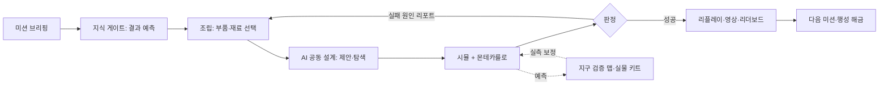

# Kinetra 최종 기획안 — 행성 물리 샌드박스

> 표기: **[추정]** 근거 없는 판단, **[확인 필요]** 채택 전 검증할 사실, **[제안]** 이 문서가 새로 제시하는 기준. 표기 없는 수치는 이 프로젝트에서 측정했거나 오늘 API로 확인한 값이다. 팀 규모는 1~2인으로 가정했다 [추정].

## 1. 한 줄 정의와 존재 이유

**정의:** 빈 행성 평지에서 실제 재료와 부품으로 무엇이든 조립하고, 그 상상이 물리적으로 되는지를 확률과 가정까지 함께 보여주는 실사풍 물리 샌드박스.

| 관점 | 내용 |
|---|---|
| Halo(상상) | 사람이 떠올린 아이디어를 "되는가"로 판정하고, 된 것은 게임·영상·수업·키트로 이어 붙인다. 판정이 제품의 심장이다. |
| 사업 | 초기에 돈을 내는 쪽은 플레이어가 아니라 수업·행사를 여는 교사·기관일 가능성이 높다 [추정]. 그래서 첫 판매 단위는 게임 패키지가 아니라 "수업 1차시 + 학급 대회" 묶음이다. |

두 관점은 자동으로 이어지지 않는다. Halo는 방향을 정하고, 사업은 12주 안에 지불 의사 한 건으로 검증한다.

## 2. 창업자 구상 정리

- **형식:** 마인크래프트식 샌드박스(빈 평지에서 발사대·기지·차량을 짓는다). 블록·복셀이 아니라 실사 외형과 현실에 가까운 물리.
- **무대:** 로켓이 아니라 행성 맵(달, 화성 등)이 먼저. 탐사 미션을 세우고 실제 재료를 골라 조합해 행성을 공략한다.
- **AI:** 공동 설계자. 차량이든 무엇이든 함께 조립하고, 제어기와 파라미터는 autoresearch로 최적화한다. 단계마다 지식이나 최적화가 있어야 넘어간다.
- **교육:** 학생·교사가 주제를 떠올리고 → 사고실험으로 즐기고 → 정말 되는지 시험한다. Physical AI 교육까지 간다.
- **커스터마이즈:** 스킨, 재료 물성(경도 등), 제어.
- **확장:** 과학의 날 경진, 맵, 레이싱, 이후 서로의 구조물을 부수는 멀티.
- **순서:** 교육 + 미디어 + 애니·게임에서 시작해 장기적으로 하드웨어 키트 E2E.
- **버린 것:** 테슬라 로드스터 뒤집기 같은 단발 히어로 데모.

## 3. 세 가지 루프

- **게임 루프(분 단위):** 조립 → 시험 → 실패 원인 확인 → 수정. 조립 모드에서는 물리를 끄고, 시험할 때 모델을 컴파일한다. 실패 리포트(전복, 슬립, 토크 부족, 파단, 에너지 고갈)가 재도전 동기를 만든다.
- **교육 루프(차시 단위):** 영상 도입 5분 → 예측 → 조립·시험 → 예측과 결과 비교 → 학급 리더보드. 교사는 설계 스펙과 실패 이력을 본다.
- **AI 설계 루프:** 학생이 목표와 제약을 말하면 AI가 스펙 변경안을 내고, 시뮬이 판정하고, AI가 원인을 설명한다. 학생이 탐색 범위를 좁혀야 autoresearch가 돌아간다(5절).

## 4. 세계 설계

**평지 시작.** 맵 하나는 수 km 크기의 국소 지형이다. 구형 행성과 궤도는 MVP에서 뺀다. 첫 행성은 달을 권한다. 대기가 없어 공기역학을 통째로 생략할 수 있고, 검은 하늘과 단일 광원이라 실사 조명 비용이 가장 낮다 [추정]. 화성은 얇은 대기와 먼지가 들어가므로 두 번째다.

**행성별 물리 상수.** 수치는 코드에 박지 않고 출처가 붙은 데이터 파일로 둔다.

| 항목 | 출처 유형 |
|---|---|
| 중력, 반지름, 자전 주기, 일사량 | NASA 행성 팩트시트, JPL 천체력 계열 공개 자료 |
| 지형 고도 | 달·화성 궤도선 고도계 기반 공개 DEM |
| 대기 밀도·온도(화성) | 공개 대기 기준 모델·기후 데이터베이스 |
| 표토 마찰·지지력 | 착륙선·로버 임무 논문과 모의토 실험 논문. 범위가 넓어 분포로 입력한다 |

**재료 시스템.** 물성 DB(밀도, 항복강도, 탄성계수, 허용 온도) → 파라메트릭 부품(빔, 판, 휠, 모터, 배터리) → 구조(조인트로 결합). 질량과 관성은 CAD 형상 × 밀도로 자동 계산한다. 물성은 공개 핸드북·제조사 데이터시트·교과서 표에서 가져오고 항목마다 출처를 남긴다. pymatgen(2.0k)은 결정 구조·계산 재료과학용이라 공학 물성표 용도와는 맞지 않는다 [추정]. 카탈로그에 없는 사양은 "카탈로그 밖"으로 표시한다. 6.5 kN 노즐이 필요한데 카탈로그에는 8.9 N뿐이던 문제를 숨기지 않는 장치다.

**탐사 미션.** 미션 = 시작 조건 + 목표 + 예산(질량, 에너지, 비용) + 판정식. 첫 미션 [제안]: 달 평지에서 로버를 조립해 크레이터 사면을 넘어 탑재체를 목표 지점에 놓는다. 필요한 지식은 무게중심과 전복, 견인력과 중력의 관계, 모터 토크와 경사, 에너지 예산, 비강도다.

**"현실과 거의 동일"의 정직한 범위.**

| 구분 | 내용 |
|---|---|
| 된다 | 강체 동역학, 중력, 관절·모터(토크-속도 곡선), CAD 기반 질량·관성, 쿨롱 마찰, 에너지 수지, 탄도 |
| 근사 | 바퀴-표토 접촉(마찰·구름저항 계수), 공기저항(집중 계수), 구조 파괴(조인트 파단 임계값), 열(집중 모델), 배터리 |
| 안 된다 | CFD, 연소, FEM 파괴·피로, 대규모 입자 표토, 방사선, 생명유지 화학 |

이 프로젝트의 판정은 가정에 따라 13%↔77%로 흔들렸고, 추력 잡음 ±10%에 15%가 약 1%로 떨어졌다. 따라서 대외 문구는 "현실과 동일"이 아니라 **"가정을 공개한 강체 수준 시뮬레이션, 불확실성 포함"**이어야 한다. 모든 판정 화면에 가정표와 민감도(어느 가정이 결과를 뒤집는가)를 붙인다.

## 5. AI 공동 설계자와 Physical AI 교육

| AI가 한다 | AI가 하지 않는다 |
|---|---|
| 자연어를 설계 스펙(JSON) 변경안으로 번역 | 판정 선언(판정은 시뮬과 몬테카를로만 한다) |
| 카탈로그 안에서 부품·재료 제안 | 카탈로그에 없는 부품을 지어내기 |
| 롤아웃 데이터로 실패 원인 설명 | 물리 상수·물성 변경 |
| 제어기·파라미터 탐색 실행 | 물리 부품의 메시 생성 |
| 힌트, 퀴즈, 사고실험 대본 초안 | 지식 게이트를 건너뛴 자동 풀이 |

**지식 게이트.** 문제 풀이가 아니라 예측 내기로 만든다. 학생이 "이 경사를 넘으려면 토크가 이 범위"라고 탐색 범위를 정하면 그 범위 안에서만 최적화가 돈다. 범위가 정확하고 좁을수록 탐색 예산이 적게 든다. 지식이 곧 게임 자원이 되므로 "단계마다 지식이 필요하다"는 구상이 숙제가 아니라 규칙이 된다.

**autoresearch의 역할.** 기존 자산(CMA-ES, 필요조건 스크린, 몬테카를로 p_success + CI, 판정 비대칭)을 그대로 쓴다. 용도는 ① 제어 파라미터 탐색, ② 가정 민감도 분석, ③ 지구 검증 맵 실측값으로 계수 보정이다. 지금까지의 보정은 합성 데이터로만 해봤다.

**실제 로봇 연결.** 3단계로 간다. ① 시뮬에서 찾은 제어 파라미터를 저가 키트 차량에 그대로 넣어 비교한다. ② mujoco_playground(2.3k) 계열로 정책 학습을 수업 주제로 올린다. GPU가 필요하므로 학교 환경에서는 서버 제공이 전제다 [추정]. ③ LeRobot(28.8k) 호환 데이터·정책 형식으로 내보낸다. sim-to-real은 어렵고 현재 실물 검증은 0건이므로 ①이 통과하기 전에는 ②③을 약속하지 않는다.

## 6. 실사 에셋 전략

- **원칙:** 시각 메시와 물리 모델을 분리한다. 같은 파라메트릭 정의에서 ① 고해상도 시각 메시(glTF + PBR)와 ② 충돌 형상(볼록체·기본형)과 질량·관성을 함께 뽑는다. build123d(3.7k) 파이프라인이 이미 있다.
- **재질:** Poly Haven(CC0)의 PBR 텍스처와 HDRI. 금속, 복합재, 고무, 표토부터 만든다.
- **참고 모델·소품:** nasa/NASA-3D-Resources(3.9k). 사용 조건과 로고·기장 제한은 [확인 필요].
- **지형:** 공개 DEM에 절차적 디테일(FastNoiseLite 3.6k)을 얹는다.
- **AI 생성 메시(Hunyuan3D-2 15.4k, TRELLIS 14.2k):** 장식과 스킨에만 쓴다. 물리 부품에는 쓰지 않는다. 모델 라이선스는 [확인 필요].
- **양보다 질:** 잘 만든 부품 20~30종이 엉성한 300종보다 낫다. 원통·상자 외형은 MVP 합격 기준에서 탈락 사유다.
- **내부 제작 도구:** blender-mcp(33.8k)는 사용자 기능이 아니라 제작 보조로만 쓴다.

## 7. 미디어에서 시뮬레이션으로

- **같은 자산을 쓴다.** 영상은 AI 영상이 아니라 시뮬 리플레이를 렌더한 것이다. 영상 속 장면이 곧 플레이 가능한 시나리오다.
- **형식:** 60~90초 사고실험("달에서 이 바퀴로 이 언덕을 넘을까?") → 판정 공개 → **플레이 가능한 엔드카드**(같은 파라미터로 바로 열리는 링크).
- **도구:** 기존 TTS 필름 파이프라인, 설명 그래픽은 ManimCE(42.4k)나 Motion Canvas(19.7k), 편집은 MoviePy(15.1k). Remotion(72.1k)은 개인과 직원 3명 이하 영리 조직까지 무료이고 그보다 큰 회사는 Company License가 필요하다. 지금 규모에서는 쓸 수 있지만 팀이 커지면 비용이 생긴다. 영상 생성 모델(Wan2.1, HunyuanVideo, LTX-Video)은 물리와 무관한 배경 컷에만 쓴다. 물리적으로 틀린 영상은 판정 브랜드를 직접 깎는다.
- **한계:** 미디어는 유료 고객으로 가는 깔때기가 아니다(이전 토론 합의). 역할은 수업 도입부와 인지도 두 가지다. 청소년 항공우주 대회에 "AI활용 우주 SF 웹툰" 종목이 있다는 점은 이 조합에 수요가 있을 수 있다는 정황일 뿐 증거는 아니다.
- **측정:** 엔드카드에서 시뮬 실행으로 넘어간 비율.

## 8. 경진, 멀티, 파괴

| 단계 | 내용 | 필요 기술 |
|---|---|---|
| 1 | 비동기 리더보드: 스펙 + 제어기 + 시드를 제출하면 서버가 다시 시뮬한다 | 서버 권위, 결정론적 리플레이 |
| 2 | 학급·학교 대회(과학의 날 형식), 교사 대시보드 | 방 코드, 제출 마감 |
| 3 | 고스트 레이싱(남의 리플레이와 경주) | 리플레이 저장 |
| 4 | 소규모 실시간 협동 건설 | 상태 동기화 |
| 5 | PvP 파괴 | 서버 물리, 지연 보상 |

- **안티치트:** 클라이언트 결과를 믿지 않는다. 제출물은 설계 스펙이고 점수는 서버 재시뮬에서만 나온다.
- **결정론:** 같은 빌드·같은 서버에서의 재현성을 전제로 한다. Jolt는 README에서 시뮬레이션이 결정론적이고 입력만 복제해 원격 클라이언트에서 재현할 수 있다고 밝히지만, 문서화된 한계가 있고 플랫폼 간 결정론에는 전용 빌드 옵션이 필요하다. MuJoCo의 플랫폼 간 결정론은 [확인 필요]. 어느 쪽이든 서버 단일 환경으로 고정하면 이 문제를 피할 수 있다.
- **점수:** 한 번의 운 좋은 성공이 아니라 잡음을 넣은 N회 시드의 p_success로 매긴다. 기존 자산이 그대로 차별점이 되는 지점이다.
- **파괴:** FEM이 아니라 조인트 파단 임계값을 쓴다(하중이 임계를 넘으면 결합 해제). 임계값은 재료 물성과 결합부 단면에서 계산한다. NVIDIA Blast(458)는 채택하지 않는다.
- **도입 시점:** 1~2단계는 MVP 범위, 3단계는 그 직후다. 4~5단계는 Go 판정 이후로 미룬다. 네트워킹은 그때 Colyseus(7.5k, MIT)나 Nakama(13.7k, Apache) 중 하나를 고른다.

## 9. 오픈소스 스택 추천

**결정: 지금은 웹(three.js + R3F) + 서버 권위 MuJoCo. Godot + Jolt는 Go 판정 뒤 1~2주 스파이크로 재평가한다.**

| 기준 | 웹 + MuJoCo | Godot(119.9k) + Jolt(12.3k) |
|---|---|---|
| 기존 코드 재사용 | R3F 리플레이, 라이브 스트리밍, 탐색·판정 전부 | 클라이언트를 새로 쓴다 |
| 학교 배포 | 설치 없이 링크로 접속 | 설치 필요. 웹 내보내기의 제약은 [확인 필요] |
| 판정 엔진과의 일치 | 같은 엔진이라 판정과 플레이가 같다 | 판정(MuJoCo)과 플레이(Jolt)가 갈라질 위험 |
| 큰 월드, 다수 물체, 파괴, 멀티 | 약하다 | 강하다. Jolt는 Godot 4.4부터 기존 Godot Physics의 대안으로 내장됐다(현재 문서 4.7) |
| 실사 렌더·지형 도구 | 직접 구성해야 한다 | 에디터와 Terrain3D(4.8k) |

근거는 세 가지다. 첫 고객이 학교라면 설치 장벽이 치명적이다 [추정]. 차별점인 판정 엔진이 MuJoCo 위에 있다. 12주 안에 엔진까지 바꾸면 검증할 것이 남지 않는다. 대신 **설계 스펙, 부품·재료 DB, 미션 정의를 엔진 독립 JSON으로** 만들어 클라이언트를 갈아 끼울 수 있게 한다. Godot 전환 조건 [제안]: 동시 물체 수나 실시간 멀티가 웹에서 막히고, Jolt로도 서버 판정과의 오차를 관리할 수 있음이 스파이크로 확인될 때.

| 영역 | 채택 | 보류·비채택 |
|---|---|---|
| 렌더 | three.js(118.0k), R3F(33.6k), drei(10.1k) | bevy(49.7k), o3de(9.9k): 학습·제작 비용 |
| 물리 | MuJoCo(17.0k) | Rapier(6.1k)는 클라이언트 미리보기 후보. Genesis, Warp, IsaacLab은 GPU 전제라 이후 |
| CAD | build123d | FreeCAD(35.3k), OpenSCAD(10.6k)는 참고 |
| 지형 | 공개 DEM + FastNoiseLite | CesiumJS(15.9k)는 구형 행성 단계에서. OpenSpace, Celestia는 참고만 |
| 우주·비행 | 없음(MVP) | JSBSim(2.3k), basilisk(419)는 비행·궤도 미션 때. poliastro는 보관 상태라 제외 |
| 운영 화면 | 없음(MVP) | nasa/openmct(13.2k)는 미션 관제 화면 후보 |
| TTS | 기존 파이프라인 | CosyVoice, F5-TTS, Kokoro의 한국어 품질과 라이선스는 [확인 필요] |

**라이선스 주의.** Celestia(GPL)는 코드를 섞지 않는다. ChatTTS(AGPL)는 서비스에 넣지 않는다. Remotion은 직원 3명을 넘는 순간 유료다. AI 메시·영상 모델, NASA 자료, CAD 커널의 조건은 채택 전에 [확인 필요]. MIT·Apache 계열(Godot, Jolt, CesiumJS, Nakama, Colyseus)은 부담이 적다.

## 10. 경쟁 구도와 차별점

아래 분류는 일반적으로 알려진 포지션이며 세부 기능은 [확인 필요]다.

| 묶음 | 제품 | 우리에게 뜻하는 것 |
|---|---|---|
| 행성 + 건설 + 파괴 + 멀티 | Space Engineers 1/2, Empyrion, Astroneer | 구상의 겉모습은 이미 시장에 있다. 콘텐츠 양으로는 이길 수 없다 |
| 우주·로켓 설계 | Kerbal Space Program, Juno: New Origins, Mars Horizon | "현실적 우주 게임" 자리는 차 있다 |
| 기계 조립 | Besiege, Trailmakers, Scrap Mechanic, Stormworks | 조립의 재미 기준선이 높다 |
| 파괴·정밀 과학 | Teardown, Children of a Dead Earth, Universe Sandbox | "가장 정확하다"는 문구로는 차별화되지 않는다 |
| 교육 | PhET, Algodoo, Minecraft Education, Roblox | 무료이거나 학교 채널을 이미 갖고 있다 |

**정직한 결론:** "실사 행성 샌드박스"라는 설명만으로는 차별점이 없다. 남는 후보는 넷이고 전부 가설이다.

1. **판정:** 성공 확률과 신뢰구간, 불가능 증명, 가정 민감도를 보여준다. 게임들은 "해보니 됐다"까지만 준다 [추정].
2. **실물 연결:** 실제 물성과 부품에서 부품표(BOM)가 나오고 키트로 이어진다.
3. **AI 공동 설계 + 지식 게이트:** 한국 교육과정과 수업 시간에 맞춘 형태.
4. **수업·대회 패키지:** 한국 교사와 행사 채널.

소프트웨어 기능은 해자가 못 된다. 해자 후보는 실측으로 보정된 부품 데이터와 채널이다.

## 11. 치명적 위험 5가지와 대응

| # | 위험 | 근거 | 대응 |
|---|---|---|---|
| 1 | **범위 폭발.** 샌드박스 × 실사 × AI × 멀티를 소수 인원이 만든다 | 템플릿 하나에 전문가 작업 수 시간 | 행성 1, 미션 1, 부품 30종 이하. 템플릿이 아니라 부품 시스템으로 전환하고 "새 부품 2시간, 새 미션 2일"을 합격 기준으로 둔다 |
| 2 | **현실성 주장 붕괴** | 판정이 가정에 흔들리고 실물 검증 0건 | 문구 수정, 가정표·민감도 상시 표시, 지구 검증 맵에서 실측 대조 |
| 3 | **돈 내는 고객 불명** | 미디어·교육·게임·하드웨어는 고객이 다르다 | 12주 동안 지불자는 교사·기관 하나로 고정. 만들기 전에 인터뷰, 12주 차에 유료 의향을 확인 |
| 4 | **재미·교육·정확성 충돌** | 정확한 물리는 답답할 수 있고 게이트는 숙제처럼 느껴진다 [추정] | 주마다 플레이테스트. 첫 성공까지 걸린 시간과 자발적 재도전을 측정. 게이트는 예측 내기 형식 |
| 5 | **카탈로그·에셋 비용** | 6.5 kN 대 8.9 N, 상자·원통 외형 | 미션이 요구하는 부품군만 만든다(로버: 프레임, 휠, 모터, 배터리). 사양 범위는 데이터시트에서, 범위 밖은 표시 |

추가로, 엔진을 둘로 가르면 판정과 플레이가 달라지고 AI 호출 비용이 수업 단가를 넘을 수 있다 [추정]. 앞의 것은 9절의 결정으로, 뒤의 것은 탐색 예산 규칙으로 묶는다.

## 12. 로드맵과 Go/No-Go

**MVP 정의:** 달 평지 맵 1개, 로버 미션 1개, 부품 30종 이하, 재료 5종 안팎, AI 제안·설명, 판정 리포트, 비동기 리더보드, 수업안 1차시. 궤도, 로켓, 기지 건설, 실시간 멀티, 화성은 넣지 않는다.

| 주 | 산출물 |
|---|---|
| 1 | 교사·학생 인터뷰 10건 [제안], 미션 1쪽 명세, 가정표 양식, 부품·재료 JSON 스키마 |
| 2 | 달 평지 + 크레이터 1개 맵, 출처 붙은 상수 파일, 고정 로버 1대가 기존 스트리밍으로 주행 |
| 3 | 부품 시스템: 프레임, 휠, 모터, 배터리, 탑재체. 정의 하나에서 시각 메시와 물리 모델 자동 생성 |
| 4 | 조립 UI(스냅 결합, 조립↔시험 전환), 질량·무게중심·에너지 표시 |
| 5 | 재료 선택이 질량과 파단 임계값에 반영. 파단 시 결합 해제 |
| 6 | 미션 판정: p_success + CI, 실패 원인 리포트, 가정 민감도 |
| 7 | AI 공동 설계자: 스펙 변경안, 실패 설명, 카탈로그 밖 요청 거절 |
| 8 | 지식 게이트 3개, 제어 파라미터 autoresearch와 탐색 예산 연동 |
| 9 | PBR·조명 정리, 리플레이로 60초 영상 자동 생성, 플레이 가능한 엔드카드 |
| 10 | 비동기 리더보드(서버 재시뮬), 교사용 수업안과 대시보드 최소판 |
| 11 | 수업 파일럿 2회 [제안], 계측 |
| 12 | 지구 검증 1건: 같은 부품 체계의 키트 차량 등판 한계를 예측하고 실측과 대조. Go/No-Go 회의 |

**Go/No-Go 기준.** 아래 수치는 모두 이 문서의 **제안값**이며 근거 데이터가 없다. 1주 차 인터뷰 뒤에 확정한다.

| 지표 | Go 기준 [제안] |
|---|---|
| 처음 보는 중학생이 30분 안에 도움 없이 첫 미션 성공 | 60% 이상 |
| 성공 뒤 자발적으로 설계를 바꿔 재도전 | 50% 이상 |
| 파일럿 교사 중 "다음 학기에 쓰겠다" | 5명 중 3명 이상 |
| 유료 의향(의향서나 유료 파일럿) | 1건 이상 |
| 새 부품 추가 / 새 미션 추가 소요 | 2시간 이하 / 2일 이하 |
| 같은 스펙·시드의 서버 재시뮬 일치 | 100% |
| 지구 검증의 예측-실측 오차 | 15% 이하 |
| 엔드카드에서 시뮬 실행 전환 | 5% 이상 |

판정 규칙 [제안]: 유료 의향과 재시뮬 일치는 필수, 나머지 6개 중 4개 이상이면 Go. 미달이면 화성과 멀티로 넘어가지 않고 13절의 좁은 길로 되돌아간다.

**이후 단계(Go일 때만):** ① 화성 맵과 미션 3~5개, 고스트 레이싱, 학교 대회. ② Godot 스파이크, 협동 건설, 조인트 파괴 PvP. ③ 키트 E2E와 LeRobot 연결.

## 13. 이전 권고(물로켓 웨지)와의 관계

이전 토론의 결론은 "기능 목록만으로는 해자가 없으니 실측이 가능한 좁은 쐐기(물로켓 과녁 대회)로 들어가라"였다. 이번 기획은 그 권고를 **뒤집는 것이 아니라 위치를 바꾼다.**

- **달라진 점:** 주력 제품이 로켓 계산기가 아니라 행성 샌드박스다. 무료 물로켓 시뮬이 이미 많으므로 그것만으로는 제품이 안 된다는 점은 그대로 인정한다.
- **유지되는 점:** 실측이 없으면 판정을 믿을 수 없다. 그래서 **지구 검증 맵**을 둔다. 같은 부품·재료 체계로 실제로 만들 수 있는 것(키트 차량, 이후 물로켓 과녁 맞히기)을 예측하고 측정해 계수를 보정한다.
- **역할 분담:** 행성 맵은 동기와 상상, 지구 맵은 신뢰와 판매 채널이다. 교구·행사 패키지로 판다는 사업 형태의 권고도 그대로 가져온다.
- **정직한 비용:** 범위는 넓어지고 수요 근거는 약해졌다. 물로켓 쐐기에는 기존 대회와 실측이라는 근거가 있었지만 행성 샌드박스에는 아직 창업자의 확신뿐이다. 12주 기준을 못 넘기면 물로켓·교구 쪽이 기본 대안이다. "시뮬을 완벽히 하고 두 번 날린 팀보다 열 번 시험 비행한 팀이 이긴다"는 현장 조언은 지구 맵을 실측 횟수를 대체하는 것이 아니라 늘리는 도구로 설계해야 한다는 뜻이다.

## 14. 결론

**이어간다. 단, 12주짜리 조건부로.** 비전을 줄이는 것이 아니라 증명 순서를 정하는 것이다.

1. **먼저 할 일(1주 차):** 코드를 쓰기 전에 교사·학생 인터뷰 10건과 미션 1쪽 명세. 지불자를 한 부류로 고정한다.
2. **만들 것:** 달, 로버 미션 1개, 부품 30종 이하. 웹 + 서버 권위 MuJoCo. 기존 자산(탐색, 몬테카를로, 판정 비대칭, CAD 폐루프, 스트리밍, TTS 필름)을 모두 재사용한다.
3. **지킬 것:** "현실과 동일"이라고 말하지 않는다. 가정과 불확실성을 공개하는 것이 제품의 정체성이다. AI는 판정하지 않는다. 물리 부품에는 AI 메시를 쓰지 않는다.
4. **미룰 것:** 화성, 궤도, 실시간 멀티, PvP 파괴, Godot 전환, 로봇 학습, 하드웨어 키트. 전부 Go 판정 뒤다.
5. **멈출 조건:** 12주 차에 유료 의향이 0건이거나 처음 보는 학생이 혼자 성공하지 못하면 샌드박스 확장을 멈추고 지구 검증 맵 중심의 교구·대회 패키지로 좁힌다.

가장 큰 불확실성은 기술이 아니라 **"누가 왜 돈을 내는가"**다. 12주 계획 전체가 그 질문 하나에 답하도록 짜여 있다.
